# Sprint 4 Test Report: ORCA Engine & Communication Stack

_Generated by `backend/scripts/generate_sprint4_report.py` from `docs/sprint4/performance/*.json`. Benchmarks generated 2026-10-06T13:14:18 UTC; E2E run 2026-10-06T13:26:26 UTC._

## Summary

All 19 acceptance criteria pass on real infrastructure (NATS JetStream 2.10.29, PostgreSQL 16 + TimescaleDB 2.30.2, real HTTP/WebSocket UI). No mocks stand in for NATS, TimescaleDB or the ORCA solver in any acceptance test.

## Environment

| Component | Version |
|---|---|
| OS | Windows 11 (10.0.26200) |
| Architecture | AMD64 |
| Python | 3.10.11 |
| Node.js | v22.17.0 |
| PostgreSQL | PostgreSQL 16.15 (Debian 16.15-1.pgdg13+2) on x86_64-pc-linux-gnu, compiled by gcc (Debian 14.2.0-19) 14.2.0, 64-bit |
| TimescaleDB (Apache-2.0 edition) | 2.30.2 |
| PostGIS | 3.6.4 |
| NATS server | 2.10.29 |
| Docker | Docker version 29.5.3, build d1c06ef |

Host: AMD Ryzen 5 5600H with Radeon Graphics (12 logical CPUs), everything (backend, NATS, PostgreSQL in Docker, browser) on one machine. Benchmarks ran with no performance tuning.

## Acceptance results

| Area | Criterion | Target | Measured | Result | Evidence |
|---|---|---|---|---|---|
| ORCA | Engine runs at 10 Hz | 10 Hz, 0 missed cycles (30 s benchmark) | 9.998 Hz, 0/300 missed; live demo 10 Hz | **PASS** | [04](evidence/04_orca_avoidance.png) |
| ORCA | 50 consecutive 8-drone runs | 0 collisions | 50 runs / 400 drone-runs, 0 collisions, min separation 5.998 m | **PASS** | [06](evidence/06_orca_8_drone.png) |
| ORCA | Conflict resolution time | < 500 ms | avg 0.43 ms, max 0.84 ms | **PASS** | [04](evidence/04_orca_avoidance.png) |
| ORCA | Amber alert before intersection | >= 3 s | first alert at TTC 10 s | **PASS** | [03](evidence/03_orca_collision_prediction.png) |
| ORCA | ORCA unit tests | >= 20 | 29 engine + 50-run acceptance | **PASS** | - |
| NATS | Message delivery latency | < 50 ms | benchmark p99 2.04 ms, max 3.09 ms, 0 over 50 ms; live max 6.25 ms | **PASS** | [07](evidence/07_nats_messages.png) |
| NATS | JetStream replay | complete and ordered | 150/150 replayed, ordered=True; durable resumed 50/50 | **PASS** | [08](evidence/08_nats_replay.png) |
| NATS | 24 h retention window | max_age 24 h | stream max_age 24.0 h, file storage | **PASS** | - |
| NATS | NATS tests | >= 15 | 21 | **PASS** | - |
| Comms | Link monitoring rate | 2 Hz | 2.0 Hz | **PASS** | [12](evidence/12_fleet_link_status.png) |
| Comms | Wi-Fi -> LTE fallback | < 1 s | avg 206 ms, max 437 ms (n=10) | **PASS** | [10](evidence/10_communication_lte.png) |
| Comms | LTE -> LoRa fallback | < 1 s | avg 209 ms, max 470 ms (n=10) | **PASS** | [11](evidence/11_communication_lora.png) |
| Comms | Fallback in the live UI flow | < 1 s | max 211 ms | **PASS** | [11](evidence/11_communication_lora.png) |
| TimescaleDB | 16 drones x 1 Hz ingestion via NATS | 0 rows lost | 960/960 rows, 0 missing, 0 rejected; live 16 drones reporting | **PASS** | [14](evidence/14_timescaledb_16_drones.png) |
| TimescaleDB | 1-hour query, single drone | < 500 ms | avg 22.18 ms, max 51.82 ms (3600 rows) | **PASS** | [13](evidence/13_timescaledb_telemetry.png) |
| TimescaleDB | 1-hour query, 16-drone fleet | < 500 ms | avg 205 ms, max 238 ms (57,600 rows) | **PASS** | [13](evidence/13_timescaledb_telemetry.png) |
| E2E | Playwright (Sprint 3 + Sprint 4) | all pass | 14 passed, 0 failed, 1 skipped (opt-in capture) | **PASS** | [15](evidence/15_end_to_end.png) |
| Regression | Backend pytest | all pass | 277/277 (182 pre-Sprint-4 + 95 new) | **PASS** | - |
| Regression | CBBA benchmark | < 2 s | 9/9 scenarios, worst 105.9 ms | **PASS** | - |

## ORCA

Implementation: `backend/app/services/orca/`, a port of the RVO2 ORCA algorithm (velocity obstacles, half-plane constraints, 2-D/3-D linear programs) with altitude-band and RTH-priority supervision.

| Parameter | Value |
|---|---|
| `agent_radius_m` | 1.0 |
| `safety_margin_m` | 2.0 |
| `time_horizon_s` | 5.0 |
| `timestep_s` | 0.1 |
| `max_speed_mps` | 15.0 |
| `neighbor_radius_m` | 150.0 |
| `max_neighbors` | 10 |
| `altitude_separation_m` | 8.0 |
| `prediction_horizon_s` | 10.0 |
| `degraded_uncertainty_s` | 1.0 |
| `max_uncertainty_m` | 10.0 |

**50 consecutive 8-drone runs** (`tests/test_orca_acceptance.py`, `orca_benchmark.json`): 0 collisions, 0 envelope breaches, minimum separation 5.998 m (envelope = 2 x (radius + margin) = 6 m), 231 predicted conflicts, 348 avoidance events, 400/400 drones reached their goals.

| Timing | avg | p95 | p99 | max |
|---|---|---|---|---|
| Cycle compute, 8 drones (n=16,526) | 0.29 ms | 0.49 ms | 0.65 ms | 2.48 ms |
| Conflict resolution (n=231) | 0.43 ms | 0.67 ms | 0.67 ms | 0.84 ms |
| Real-time loop interval, 30 s | 100 ms | 110 ms | 125 ms | 125 ms |

Prediction lead time (conflict predicted to avoidance applied, simulated seconds): avg 2.58 s, max 6.1 s. In the live UI the first amber alert appeared at TTC **10 s**.

Live demo (E2E TEST 2/4): 10 Hz over 685 cycles, 1 missed (interval max 156 ms), compute avg 0.328 ms / max 0.994 ms.

Altitude bands: band 0 (30 m) is reserved for RTH; cruise bands 1-4 at 40/50/60/70 m, max 8 drones per band; drones more than 8.0 m apart vertically are not ORCA neighbours.

RTH priority: critical battery (SOC <= 15 %) > emergency > communication degraded > normal; ties broken by lower SOC, then earlier request, then drone id. At most 2 drones fly home at once; the rest hold position until a slot frees.

## NATS JetStream

Stream `DRONES`, subjects `drone.*.telemetry|state|alert|command` (PRD topic `drone/{UIN}/<kind>` maps to NATS subject `drone.{UIN}.<kind>`), retention `limits`, storage `file`, max_age 24.0 h, duplicate window 120.0 s (`Nats-Msg-Id` de-duplication). Durable push consumers with queue groups: `orchestrator`, `ui`, `telemetry-writer`, `command-dispatch`.

**Delivery** (16 drones x 10 msg/s (telemetry/state/alert), publisher and consumer on separate connections): 3200/3200 delivered, 0 lost, 0 duplicates.

| Latency | avg | p50 | p95 | p99 | max | > 50 ms |
|---|---|---|---|---|---|---|
| Benchmark (n=3,200) | 1.00 ms | 1.01 ms | 1.69 ms | 2.04 ms | 3.09 ms | 0 |
| Live app, orchestrator consumer (n=2,000) | 1.41 ms | - | 2.54 ms | - | 6.25 ms | 0 |

**Replay**: published 100 (consumed), stopped the durable consumer, published 50 more, then replayed by start time: 150 messages, ordered = True, 1015 ms. The restarted durable consumer received exactly the 50 it had missed. Method: `bus.replay(kind='telemetry', uin=..., start_time=now-1s) -> ephemeral consumer DeliverPolicy.BY_START_TIME`.

## Communication fallback

Chain Wi-Fi -> LTE -> LoRa, monitored at 2.0 Hz; recovery needs the better link healthy for 3.0 s and at least 2.0 s on the current link (hysteresis).

| Link | Breach RSSI | Recover RSSI | Breach loss | Recover loss | Breach latency | Recover latency |
|---|---|---|---|---|---|---|
| wifi | -75.0 dBm | -67.0 dBm | 10.0 % | 3.0 % | 150 ms | 80 ms |
| lte | -105.0 dBm | -95.0 dBm | 15.0 % | 5.0 % | 300 ms | 150 ms |
| lora | -125.0 dBm | -118.0 dBm | 30.0 % | 10.0 % | 2000 ms | 1200 ms |

| Transition (breach injected to new link active) | n | avg | p95 | max |
|---|---|---|---|---|
| Wi-Fi -> LTE | 10 | 206 ms | 437 ms | 437 ms |
| LTE -> LoRa | 10 | 209 ms | 470 ms | 470 ms |
| Recovery to Wi-Fi (includes the 3 s hold) | 10 | 3,476 ms | 3,838 ms | 3,838 ms |

Detection dominates: a breach is seen at the next 2 Hz poll (<= 500 ms); the decision and the transport switch take < 1 ms. Live UI flow (TEST 7, DMX-003): Wi-Fi -> LTE 193 ms, LTE -> LoRa 211 ms, recovery 3,720 ms.

## TimescaleDB

Hypertable `drone_telemetry` partitioned on `timestamp` with 1 day chunks; columns timestamp, drone_id, lat, lon, alt, speed, heading, soc, rssi (+ link_type); primary key (timestamp, drone_id) with `ON CONFLICT DO NOTHING`, so redelivered messages cannot create duplicate rows. Ingestion path: simulator -> NATS `drone.{UIN}.telemetry` -> durable consumer `telemetry-writer` -> batched insert (0.2 s flush).

**16 drones x 1 Hz x 60 s through NATS**: 960/960 rows, 0 missing, 0 duplicates, 0 rejected, 0 write errors; publish-to-commit latency avg 137 ms, p95 222 ms.

| 1-hour query | rows | avg | p95 | max |
|---|---|---|---|---|
| Single drone | 3,600 | 22.18 ms | 48.28 ms | 51.82 ms |
| 16-drone fleet | 57,600 | 205 ms | 238 ms | 238 ms |

Live (E2E TEST 8): 16 drones reporting, ingestor received 1048, inserted 1048, rejected 0, write errors 0. UI query (TEST 9): drone 24.52 ms, fleet 72.67 ms.

## End-to-end tests (Playwright, `frontend/e2e/sprint4.spec.ts`)

Real browser against the real backend, NATS and database. TEST 2 + 4 and TEST 5 + 6 share one live run each (the same 8-drone demo / the same stream), so the ten required scenarios are covered by nine Playwright tests.

| # | Scenario | Key assertion | Result |
|---|---|---|---|
| 00 | Baseline | login, mission list loads, `/health` reports NATS connected and ORCA enabled | PASS |
| 1 | Two-drone collision avoided | min separation 6.006 m, 0 violations | PASS |
| 2 | 8-drone demo | avoidance on the map, 10 Hz | PASS |
| 3 | 50 x 8-drone runs | 0 collisions | PASS |
| 4 | Prediction alert >= 3 s | first alert TTC 10 s | PASS |
| 5 | NATS telemetry flow | live latency max 6.25 ms, 0 > 50 ms | PASS |
| 6 | JetStream replay | 648 messages replayed in order | PASS |
| 7 | Wi-Fi -> LTE -> LoRa -> recovery | fallbacks 193 ms / 211 ms | PASS |
| 8 | 16-drone TimescaleDB ingestion | 16 drones, 0 rejected | PASS |
| 9 | 1-hour query from the UI | 72.67 ms fleet | PASS |
| 10 | Complete flow | 76 DB rows since demo start, max telemetry gap 1033 ms | PASS |

## Regression

| Suite | Command | Result |
|---|---|---|
| Backend | `cd backend && pytest -q` | 277/277 passed in 166 s |
| Frontend lint | `npm run lint` | 0 errors |
| Frontend types | `npm run typecheck` | 0 errors |
| Frontend unit | `npm test` | 8 passed |
| Frontend build | `npm run build` | pass (main chunk > 500 kB after minification (pre-existing; advisory only)) |
| Playwright | `cd frontend && npx playwright test` | 14 passed, 0 failed, 1 skipped: e2e/screenshots.spec.ts is the Sprint 3 opt-in screen capture (runs only with SCREENSHOTS=1); it is not an acceptance test |
| CBBA benchmark | `python scripts/benchmark_cbba.py` | 9/9 scenarios < 2 s |

New backend tests by file: `test_orca_engine.py` 29, `test_orca_acceptance.py` 1, `test_nats_messaging.py` 21, `test_comms_fallback.py` 7, `test_timescale_telemetry.py` 20, `test_sprint4_api.py` 12, `test_fleet_runtime_integration.py` 1, `test_log_redaction.py` 4.

## Security

- Every Sprint 4 endpoint reuses the existing JWT auth and RBAC dependencies. Read endpoints need any authenticated role; degrade/restore/demo/command need ADMIN or OPERATOR; fleet reset needs ADMIN.
- The ORCA/comms buffers and the NATS stream are shared by all organizations, so every read endpoint (`/orca/state`, `/orca/events`, `/comms/links`, `/comms/events`, `/telemetry/*`, `/messaging/status`, `/messaging/replay`) filters to the caller's organization; replaying another organization's UIN returns 404 (tests: `test_sprint4_api.py`).
- No credentials are hard-coded: NATS and database URLs come from settings/`.env`, and `.env.example` contains local development defaults only.
- Secrets are never logged: the WebSocket handshake carries the JWT as `?token=`, and uvicorn logs request lines verbatim. A redaction filter (`app/core/logging.py`) rewrites `token`/`access_token`/`refresh_token`/`password` query values to `[REDACTED]` (tests: `test_log_redaction.py`; verified against a live uvicorn process).
- Comms degrade/restore operations are written to the audit log.

## Evidence screenshots

### 01. Baseline: Drone MatrX running with Sprint 1-3 features intact

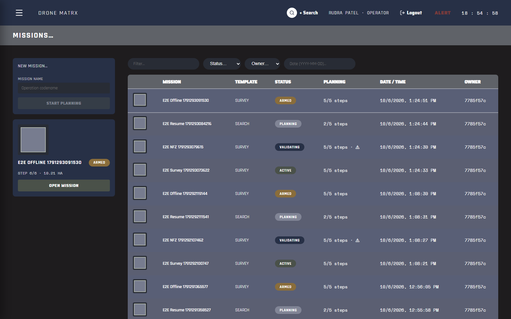

### 02. ORCA layer, normal flight: velocity vectors, planned tracks, altitude bands

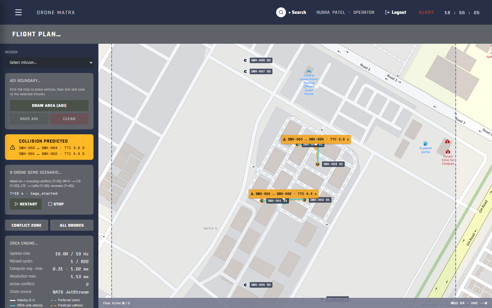

### 03. Collision predicted: amber banner and on-map TTC labels, >= 3 s ahead

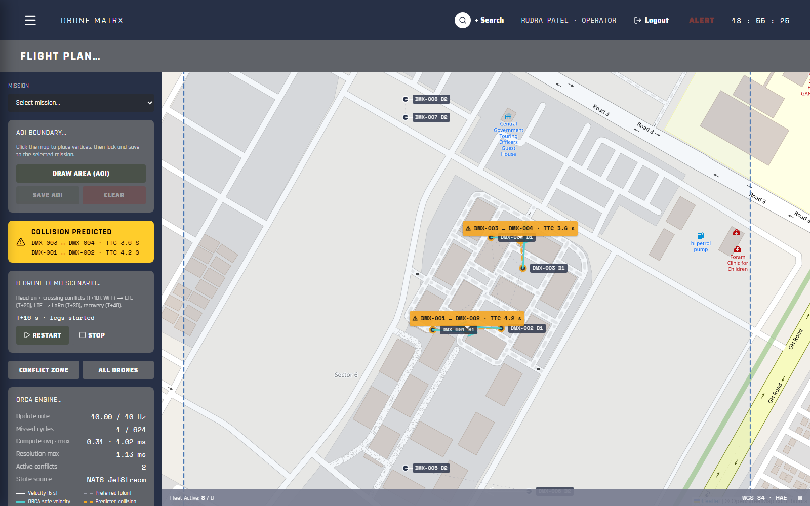

### 04. Avoidance applied: cyan ORCA-safe velocity diverging from the dashed plan

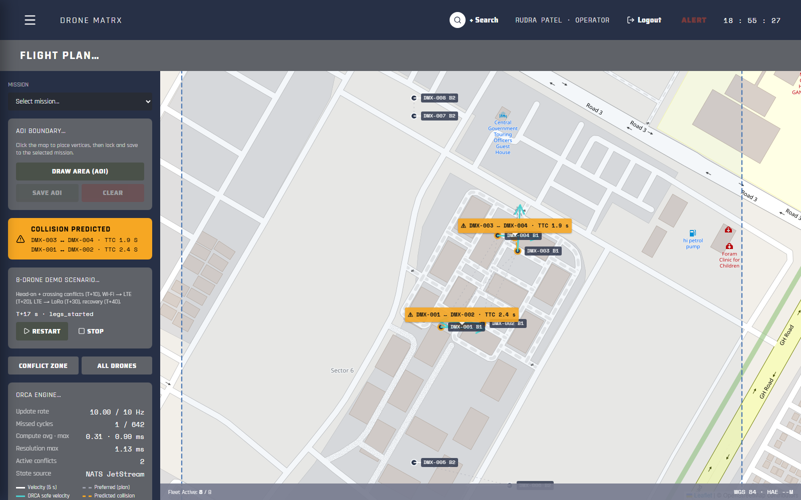

### 05. ORCA event timeline: predicted, constraint, avoidance applied/released, cleared

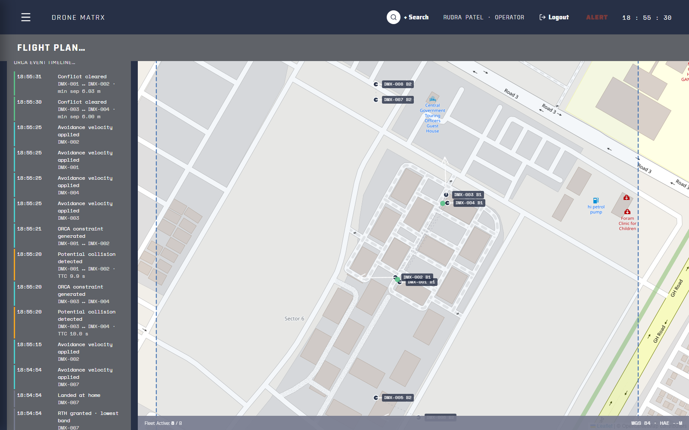

### 06. Full 8-drone demo scenario, two altitude bands

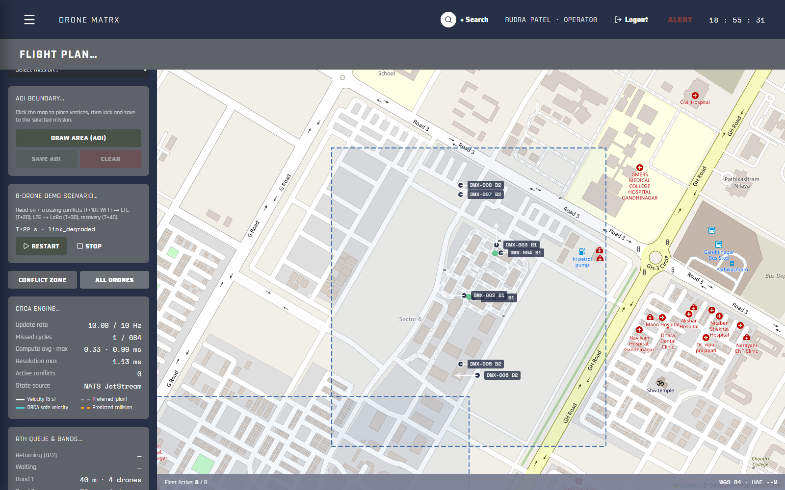

### 07. NATS JetStream: stream, durable consumers, live message flow, delivery latency

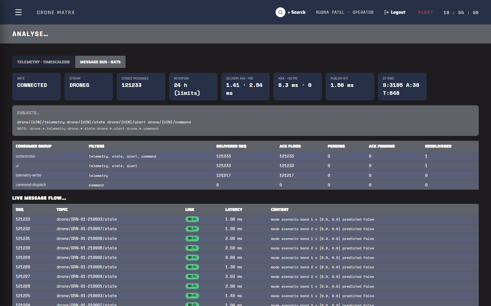

### 08. JetStream replay of the last 5 minutes of telemetry

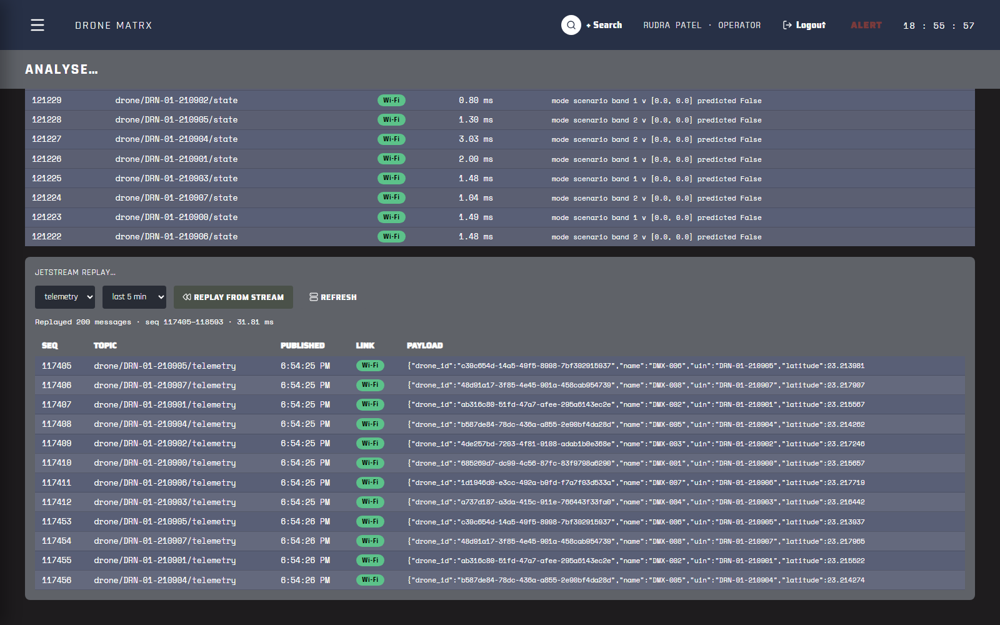

### 09. Fleet wall: every drone on Wi-Fi

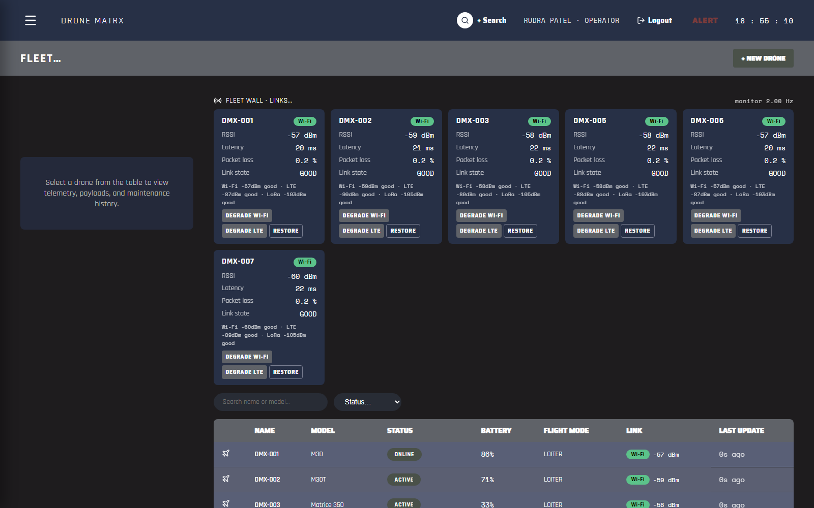

### 10. DMX-003 Wi-Fi degraded, fell back to LTE

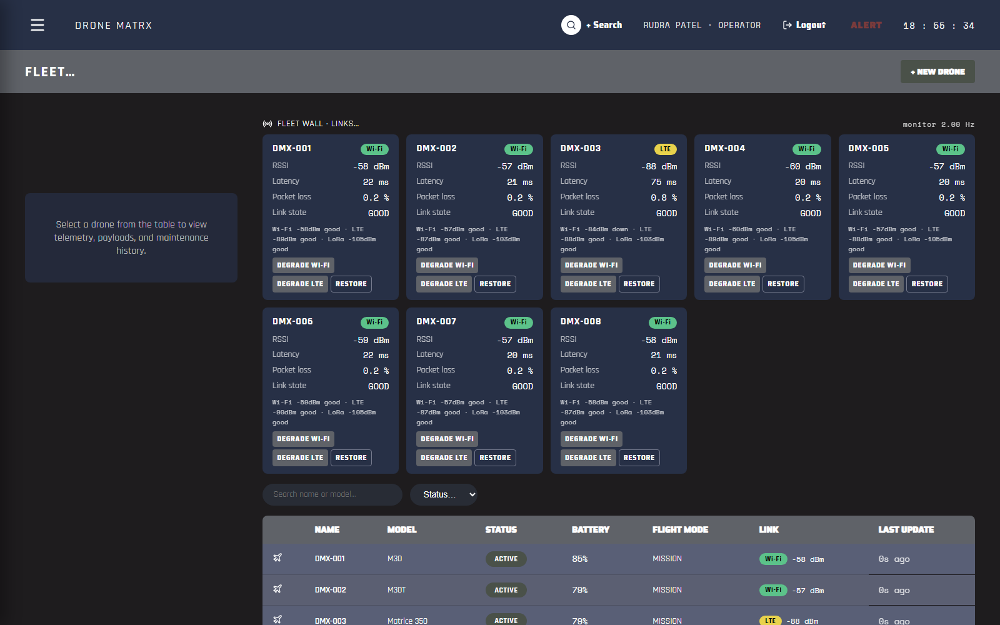

### 11. DMX-003 LTE degraded, fell back to LoRa

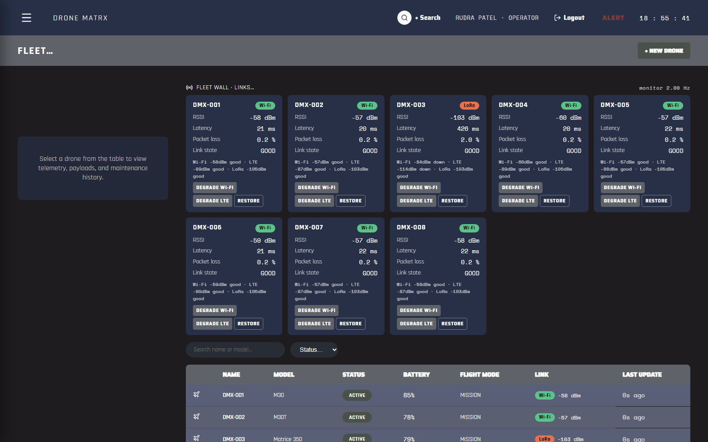

### 12. Fleet table Link column shows the per-drone active link

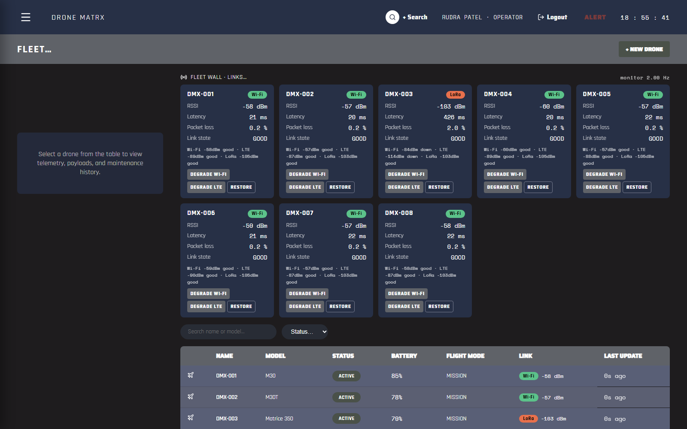

### 13. 1-hour TimescaleDB query from the UI with query timings

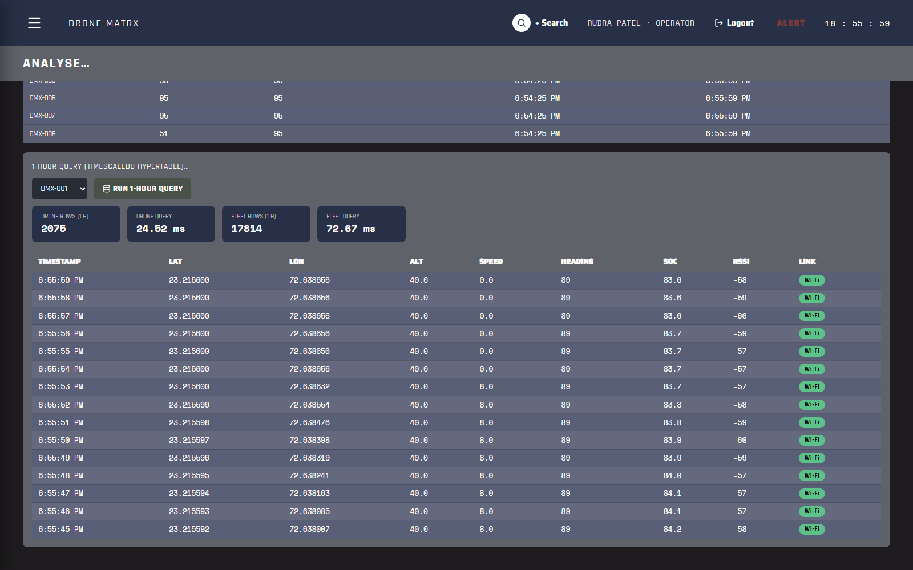

### 14. 16 drones ingesting at 1 Hz into the hypertable, 0 rejected / 0 errors

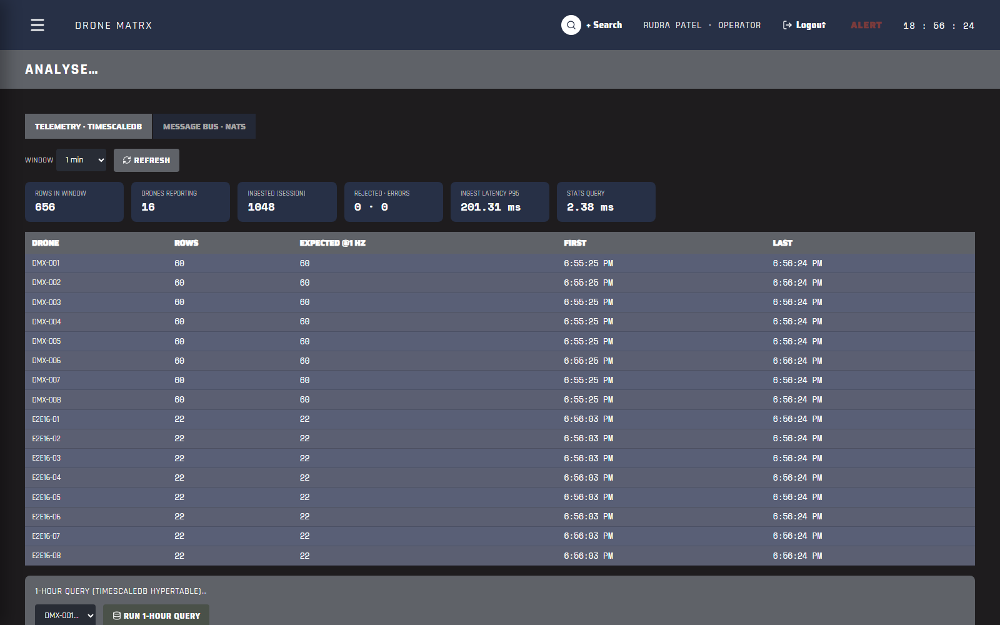

### 15. End-to-end: demo running with ORCA, comms and telemetry live

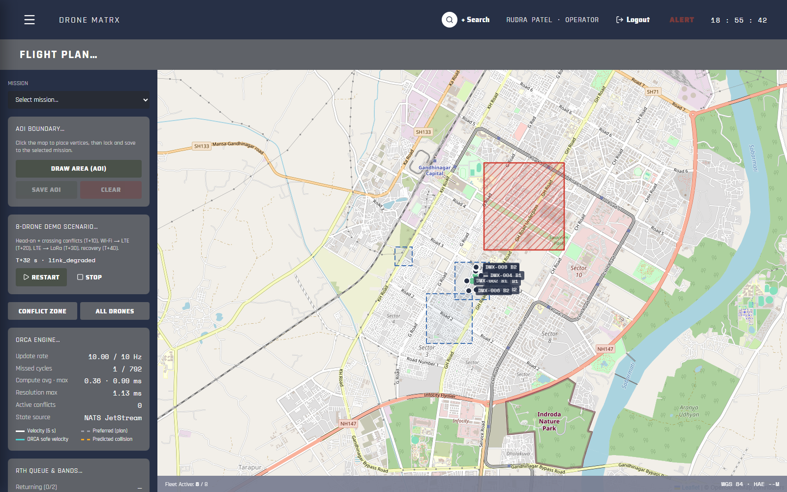

## Known limitations and observations

- **Simulated radio environment.** Link RSSI/loss/latency come from a deterministic simulated environment; the fallback logic, thresholds, hysteresis and transport switching are real, but no physical Wi-Fi/LTE/LoRa radios are involved.
- **Occasional missed ORCA cycle under host load.** The isolated benchmark loop missed 0 cycles; during the full E2E run (browser + backend + NATS + DB on one throttled laptop) the live loop missed 1 of 685 cycles (max interval 156 ms). Average rate stayed at 10 Hz and no separation was lost.
- **24 h replay** is verified as configuration (stream max_age = 24 h) plus a functional replay-by-start-time test; a literal 24-hour soak was not run.
- **TimescaleDB Apache edition** (the license available in PGDG packages) has no `add_retention_policy`; the backend enforces the 30-day retention with an hourly `drop_chunks` call instead.
- **Centralised simulation.** CBBA and ORCA run in the backend for all simulated drones; on-board/edge execution is future work.
- **Telemetry WebSocket broadcast is not organization-scoped** (unchanged from Sprint 2); the REST endpoints added in Sprint 4 are scoped.
- **Replay endpoint latency** is about 1 s per call because the ephemeral pull consumer waits out its fetch timeout on the last batch.
- **Map tiles need internet** (OpenStreetMap); everything else works offline (Sprint 3 offline E2E).
- If NATS is unreachable the backend starts in degraded mode instead of failing: telemetry goes straight to the WebSocket/UI, while TimescaleDB ingestion, replay and commands are unavailable until NATS returns (`/health` reports `nats_connected: false`).

## Reproduce

```bash
docker compose up -d                      # PostgreSQL 16 + PostGIS + TimescaleDB, NATS JetStream
cd backend && alembic upgrade head && python scripts/seed.py
pytest -q
python scripts/benchmark_sprint4.py       # writes docs/sprint4/performance/*.json
python scripts/benchmark_cbba.py
cd ../frontend && npm run lint && npm run typecheck && npm test && npm run build
npx playwright test                       # writes docs/sprint4/evidence/*.png and e2e_results.json
cd ../backend && python scripts/generate_sprint4_report.py
```
