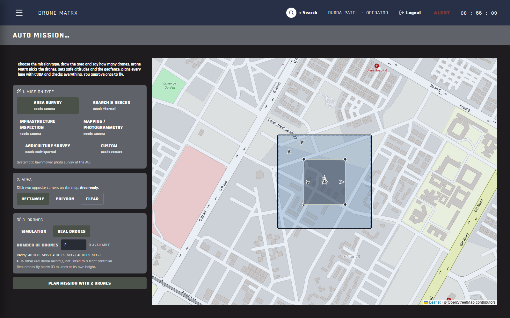
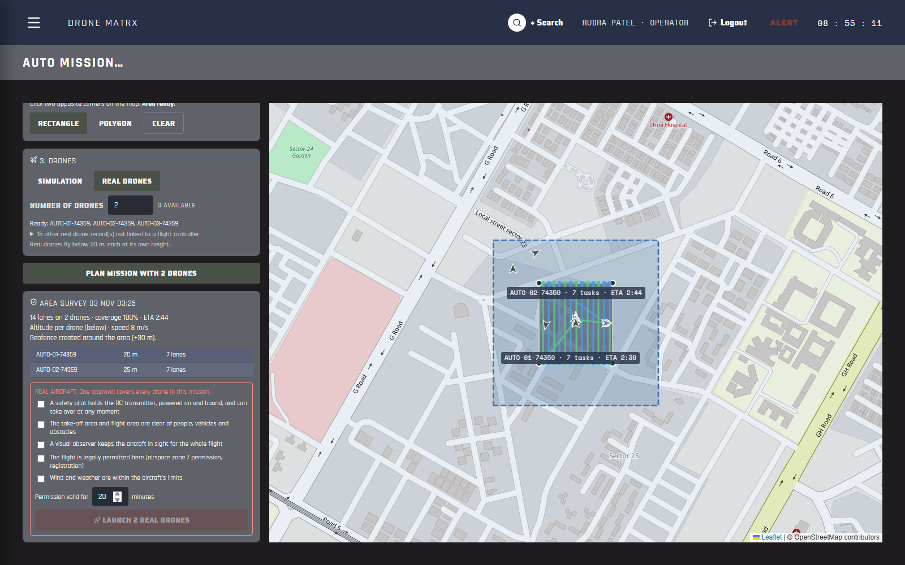
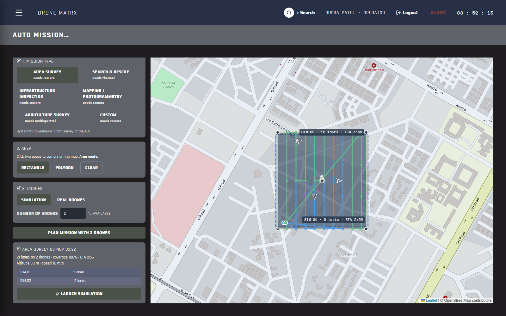
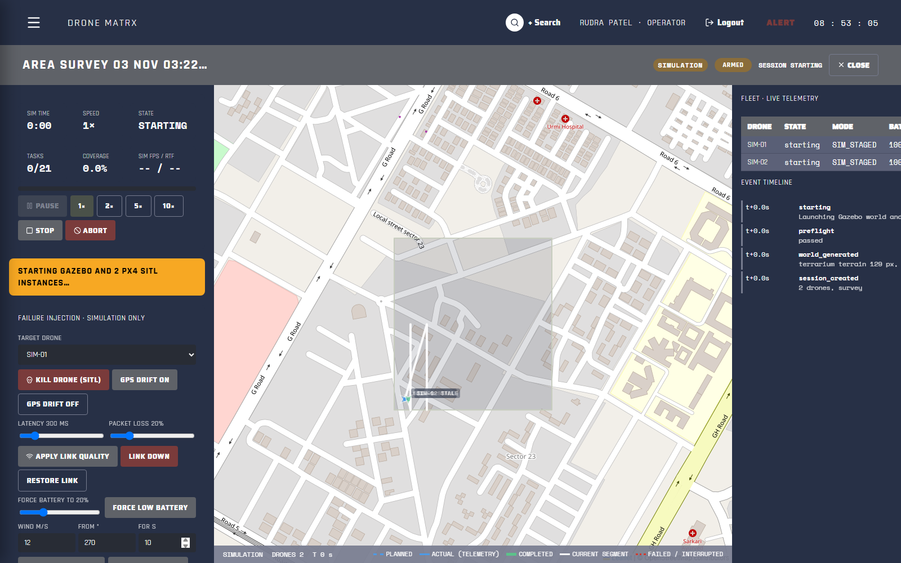
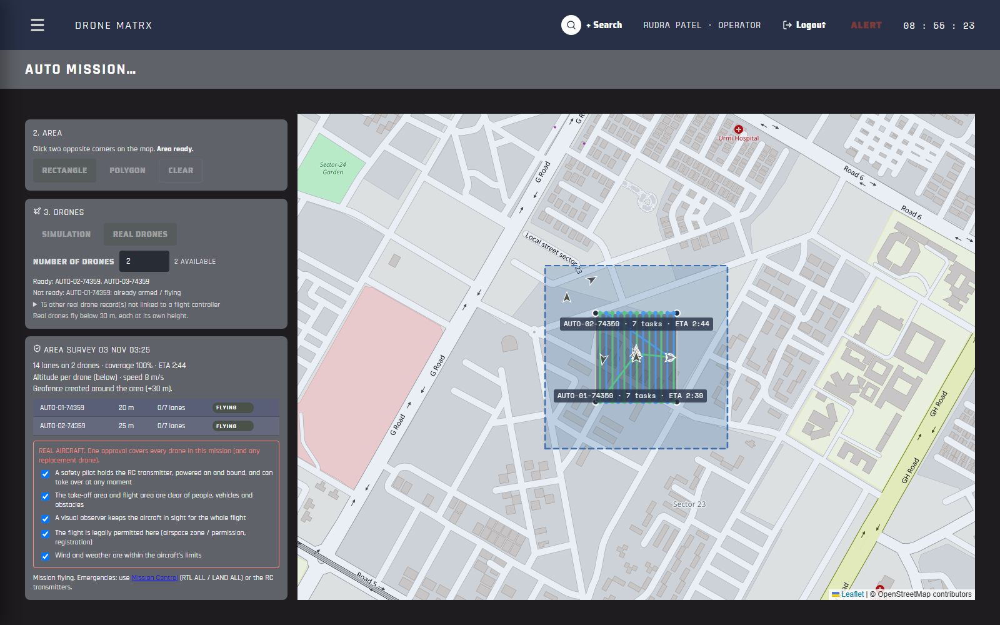
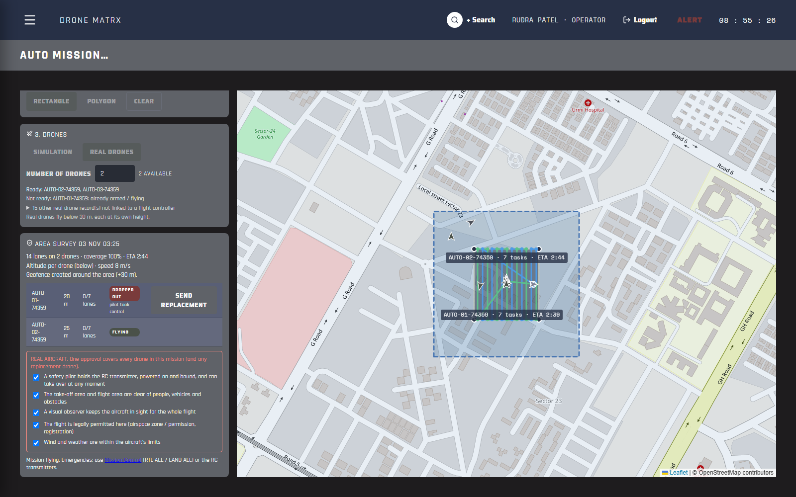

# Sprint 6.2: Auto Mission and QA hardening

**Goal of Drone MatrX:** the user selects the area, a few parameters (number of drones, mission type), and everything else is automatic. Sprint 6.2 builds that as the **Auto Mission** page and closes the findings of the Sprint 6.1 QA review.

> **About the screenshots.** Real-drone screenshots come from the real software connected to **practice vehicles** (`hwbridge/tools/practice_vehicle.py`, a MAVLink responder, not ArduPilot). The simulation screenshots come from the real Gazebo + PX4 SITL simulator. Neither is a real flight.

---

## 1. Auto Mission: what the user does

Open the menu (☰) → **Auto Mission**. Three inputs:

| Input | What it means |
|---|---|
| **Mission type** | Area Survey, Search & Rescue, Infrastructure Inspection, Mapping, Agriculture, Custom. Each card shows the sensor it needs. |
| **Area** | Click two opposite corners on the map (rectangle) or each corner (polygon). |
| **Drones** | **Simulation** or **Real drones**, and how many. The page shows how many are available, which real drones are ready, and why the others are not ("battery 30 %", "pilot override lock", "no live telemetry"...). |



Press **Plan mission with N drones**. Everything else is automatic:

| Done automatically | How |
|---|---|
| **Choose the drones** | The N ready drones with the fullest batteries. **Real and simulated drones are never mixed** (also enforced in the manual wizard). A real drone is "ready" only if it is linked to its flight controller, has live telemetry, is disarmed, has no pilot-override lock, is not in RTL/LAND, has ≥ 50 % battery and carries the sensor the mission type needs. |
| **Altitude** | Simulation: the template altitude. Real drones: below the 30 m hard limit, **each drone at its own height** (for example 20 m and 25 m), because collision avoidance doesn't steer real drones. Speed capped at 8 m/s. |
| **Geofence** | Real drones: an inclusion geofence = the area + 30 m, created automatically (the pre-arm checklist needs one). |
| **Task limits** | Sized for the area: a lower altitude means more lanes, and CBBA's real limit is each drone's energy. |
| **Plan + checks** | CBBA lanes, coverage, ETA, and every wizard validation check (NFZ, geofence, battery, readiness). |



### Launch: simulation

**Launch simulation** creates the session, generates the 3D world, runs the preflight checks and starts Gazebo with one PX4 per drone. The page opens the live simulation view.





### Launch: real drones (one approval)

Tick the **5 safety confirmations** once (safety pilots on the transmitters, area clear, observer, legal, weather) and press **Launch N real drones**. Drone MatrX then:

1. re-checks every drone's pre-arm checklist;
2. grants each drone a flight permission;
3. uploads each drone's CBBA lanes at its own altitude;
4. starts them **10 seconds apart**.

It is **all or nothing**: if any drone fails a check, nothing takes off and every permission just granted is revoked. The page says which drone and why.



The table shows each drone's state (**Flying**, **Done**, **Dropped out**, **Replaced**) and lanes flown, read straight from the flight controllers.

### If a drone drops out

If the safety pilot takes over, a failsafe triggers RTL/LAND, or a drone loses its link before finishing, its row turns **Dropped out** with the reason and the lanes it didn't fly.



**Send replacement** sends exactly those unfinished lanes to a ready drone on the ground. It flies at the dropped drone's altitude, which is free now. Because a new aircraft takes off, it uses the same 5 confirmations. Drone MatrX never rewrites the mission of a drone that is already flying.


Emergencies are unchanged: RC transmitters always win; **RTL ALL / LAND ALL** in Mission Control.

---

## 2. Start everything with one command

```powershell
cd "D:\Drone MatrX"
powershell -ExecutionPolicy Bypass -File start-dronematrx.ps1              # real drones
powershell -ExecutionPolicy Bypass -File start-dronematrx.ps1 -Simulation  # also the simulator
```

It finds the laptop's network address by itself (the video wall needs it; a wrong address used to show VIDEO LINK LOST), starts the database, NATS and MediaMTX, applies database migrations, opens the backend and the website in their own windows, and opens Auto Mission. Docker Desktop must be running.

---

## 3. QA review: what was fixed

| # | Finding (Sprint 6.1 review) | Status | Evidence |
|---|---|---|---|
| 1 | No "number of drones" input; wizard ticked every drone, mixing real and demo drones | **Fixed** | Auto Mission asks for a count and picks the drones; `MIXED_FLEET` refusal in the planner for the manual wizard too (`test_manual_wizard_refuses_mixed_fleet`) |
| 2 | Real-drone execution manual, one drone at a time | **Fixed** | One approval, all-or-nothing, staggered start (`test_one_approval_launches_the_fleet_staggered`, `test_launch_is_all_or_nothing`, walkthrough A03) |
| 3 | Template altitudes above the 30 m hard limit | **Fixed** | Per-drone altitude stack under the limit (`test_altitude_plan_separates_and_respects_the_limit`) |
| 4 | Geofence drawn by hand | **Fixed** | Auto inclusion fence from the area (`test_plan_picks_best_drones_fits_altitude_and_creates_geofence`) |
| 6 | No in-flight adaptation on real drones | **Fixed** (replacement drone) | Dropout detection + one-click replacement (`test_progress_dropout_and_replacement`, walkthrough A04–A05) |
| 7 | Start-up manual, Wi-Fi IP typed by hand | **Fixed** | `start-dronematrx.ps1` (IP detected automatically) |
| Q1 | Tests checked our own assumptions (practice vehicle only) | **Ready to run, needs you** | `hwbridge/tests/test_ardupilot_sitl.py`: 8 tests of the bridge against **real ArduPilot firmware** (SITL). The SITL binary on disk was **truncated** (an interrupted download); a complete one is in place, and `start.ps1` now downloads safely. Starting downloaded firmware needs your permission, see section 4. |
| Q2 | "Done" ticks were guesses (RC calibration) | **Fixed** | Plausible-range check plus ArduPilot's own complaints (`RC counts as calibrated only with a plausible stored range`; the test also caught a regex bug with `RC3_MIN...` messages) |
| Q3 | Flaky Gazebo crash test | **Fixed** | Waited on wall time; now waits on simulated time (it failed only when the machine was busy) |
| Q4 | Work uncommitted, no CI | **Fixed** | Sprint 6.1 committed; `.github/workflows/ci.yml` runs backend (PostGIS + TimescaleDB + NATS), bridge and frontend tests on every push |
| Q5 | `pymavlink` / `pyserial` missing from `requirements.txt` | **Fixed** | Found while writing CI: a fresh install could not run the bridge |
| 5 | Finalized perception and search stack (YOLOv8n/HIT-UAV, ByteTrack, SegFormer-B0, HSI, OpenVINS, TFMini, A* routing, team orienteering, SQLite offline, store-and-forward, adaptive coverage search) | **Not started** | Needs real camera frames, trained models and onboard compute: a separate track |
| — | ORCA collision avoidance on real drones | **Not started** | Real drones are separated by altitude only |

Bugs found and fixed during this work (each found by a new test):

- **Status lost:** Auto Mission's per-drone status wasn't saved, because SQLAlchemy doesn't notice in-place edits to nested JSON.
- **Wrong data source:** live telemetry drops mission progress and the pilot-override flag. Status now reads them from the flight controllers.
- **Unflown lanes:** at 20 m, an area needed 41 lanes but the default cap was 15 per drone, so 11 lanes would have been left unflown.
- **Unlaunchable drones offered:** drones with an override lock were listed as "ready".

---

## 4. What you need to do

1. **Run the real-firmware tests once:**
   ```powershell
   powershell -ExecutionPolicy Bypass -File sim/ardupilot_sitl/start.ps1
   backend\venv\Scripts\python -m pytest hwbridge/tests/test_ardupilot_sitl.py -v
   docker rm -f dronematrx_ardupilot_sitl
   ```
   These 8 tests replace "the practice vehicle agrees with my code" with "ArduPilot agrees". Report any failure: it means an assumption about ArduPilot was wrong, which is exactly what we want to find before a field day.
2. **Bench test (props off)** with the real drone, following `documents/hardware_test/PHYSICAL_DRONE_TEST_SCRIPT.md`, then an Auto Mission with one real drone over a small area.
3. **Push** the branch so CI runs (`git push`). The first run tells us whether the CI database image builds on GitHub.

---

## 5. Tests

| Suite | Result |
|---|---|
| Backend (full, real PostGIS + TimescaleDB + NATS + Gazebo/PX4) | **441 passed.** The full run gave 438 passed + 3 failed: two Gazebo tests and the real-terrain download test, during a run that took 5 h 48 min instead of ~35 min (laptop overloaded / asleep). All three passed when re-run alone (3 min 49 s). Timing-sensitive under heavy load, not a regression. |
| Auto Mission backend | 14 passed |
| Bridge (practice vehicles, simulated SiK radio) | 25 passed; 8 ArduPilot SITL tests skip until SITL runs |
| Frontend unit | 26 passed; lint and typecheck clean |
| Browser walkthroughs | Auto Mission real drones ✓ (57 s), Auto Mission simulation ✓ (reached "Mission started on all assigned drones"), Drone Setup ✓ |

Run the walkthroughs: `cd frontend; npx playwright test -c playwright.hw.config.ts` (needs the practice vehicles, bridge, backend, website and simulator running; see each spec's header).
