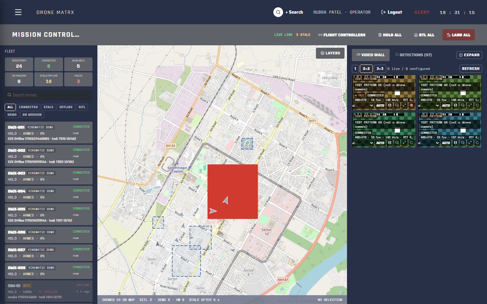
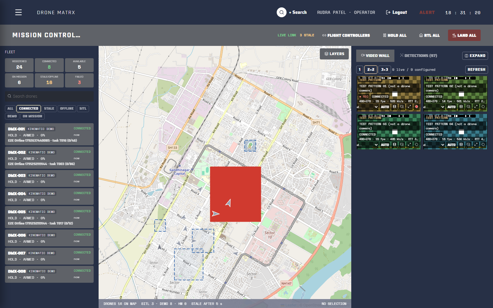
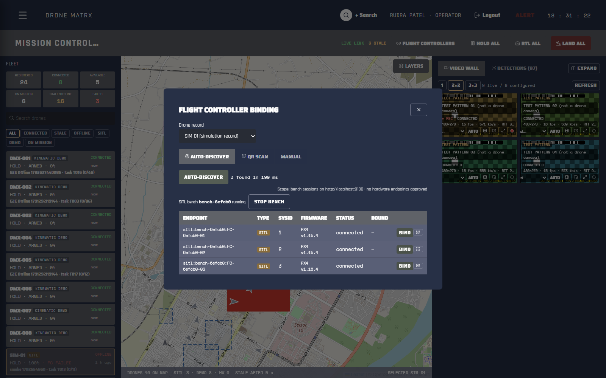
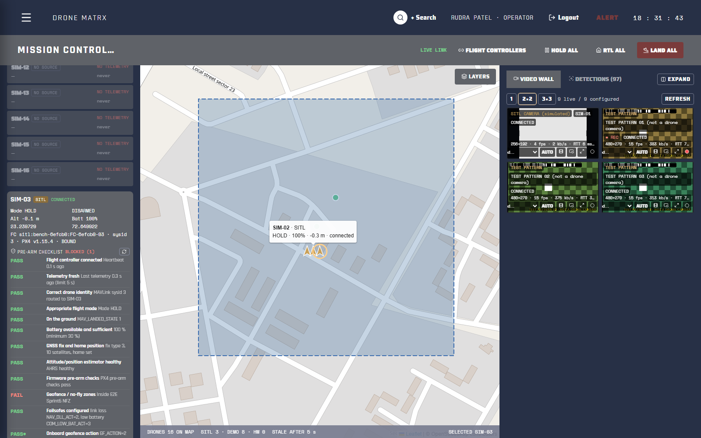
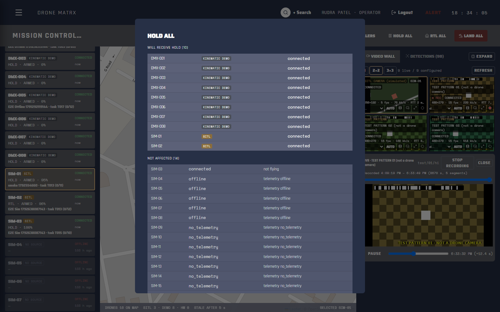
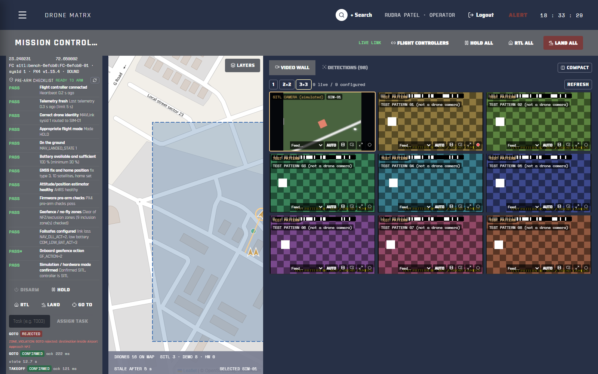
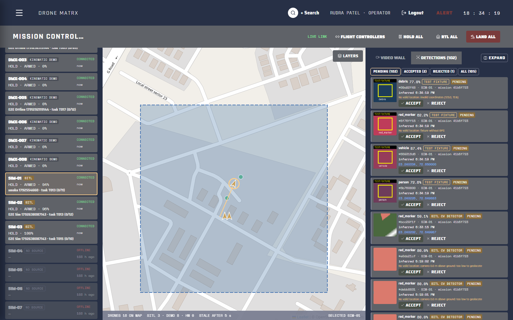
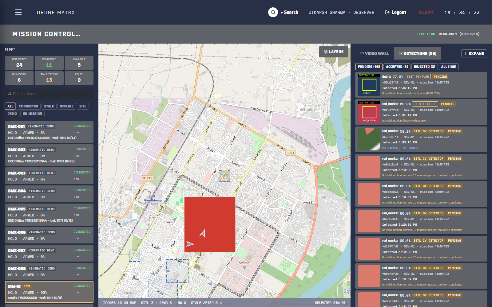
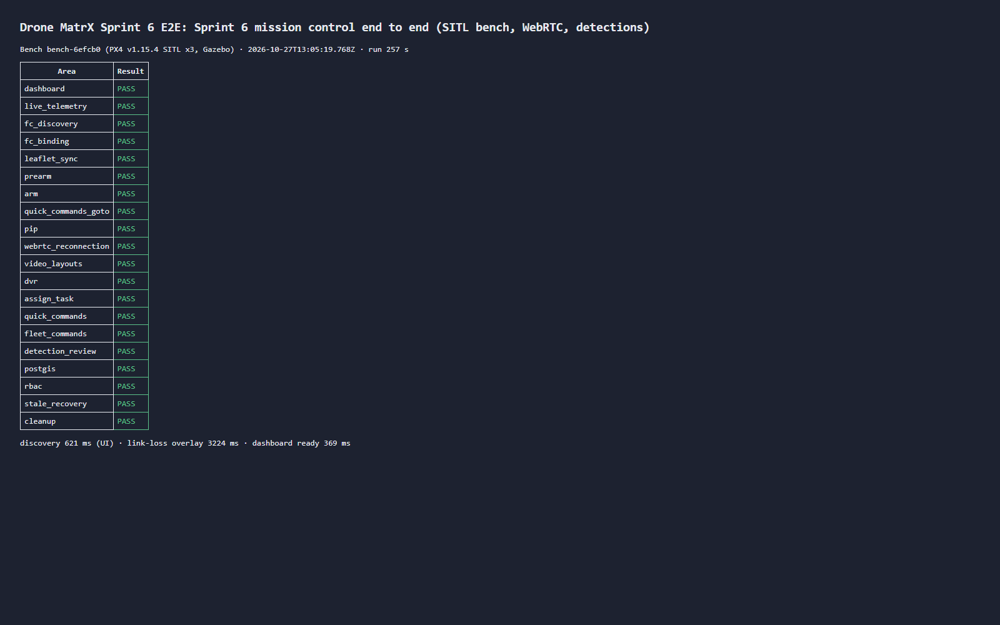

# Drone MatrX: Sprint 6 Report (Live Mission Control)

| | |
|---|---|
| **Sprint** | Sprint 6: Live Mission Control |
| **Date** | 28 October 2026 |
| **Code** | branch `sprint-6`, merged into `main` (commit `26592f7`) |
| **Status** | Implemented and tested end to end on simulated drones (PX4 SITL). Real hardware was not tested because no aircraft was available. |
| **Evidence** | 22 screenshots in [`screenshots/`](screenshots/), 2 recordings in [`recordings/`](recordings/) |
| **Technical reports** | [`docs/sprint6/SPRINT_6_TEST_REPORT.md`](../../docs/sprint6/SPRINT_6_TEST_REPORT.md), [`docs/sprint6/PERFORMANCE_RESULTS.md`](../../docs/sprint6/PERFORMANCE_RESULTS.md), [`docs/sprint6/MISSION_CONTROL.md`](../../docs/sprint6/MISSION_CONTROL.md) |

This report explains **what** Sprint 6 added to Drone MatrX and **how each part works**, from the moment an operator opens the page to the moment a command reaches a flight controller. It also covers how it was tested, the results, and what is still open.

---

## Contents

1. [Summary](#1-summary)
2. [What the operator sees: the Mission Control page](#2-what-the-operator-sees-the-mission-control-page)
3. [How the system fits together](#3-how-the-system-fits-together)
4. [Live fleet and telemetry freshness](#4-live-fleet-and-telemetry-freshness)
5. [Connecting a flight controller (discovery, QR, manual)](#5-connecting-a-flight-controller-discovery-qr-manual)
6. [Pre-arm checklist](#6-pre-arm-checklist)
7. [Commands: single drone and whole fleet](#7-commands-single-drone-and-whole-fleet)
8. [Live video wall](#8-live-video-wall)
9. [Detections: feed, review, map and heatmap](#9-detections-feed-review-map-and-heatmap)
10. [Who can do what (RBAC)](#10-who-can-do-what-rbac)
11. [How we tested without a real drone (the SITL bench)](#11-how-we-tested-without-a-real-drone-the-sitl-bench)
12. [Test results](#12-test-results)
13. [Performance results](#13-performance-results)
14. [Problems found and fixed during the sprint](#14-problems-found-and-fixed-during-the-sprint)
15. [Limitations and what was not tested](#15-limitations-and-what-was-not-tested)
16. [Screenshot walkthrough](#16-screenshot-walkthrough)
17. [How to run it yourself](#17-how-to-run-it-yourself)
18. [Where the code lives](#18-where-the-code-lives)
19. [Recommended next steps](#19-recommended-next-steps)

---

## 1. Summary

Before Sprint 6, Drone MatrX could plan missions (Sprint 3), avoid collisions and move messages between drones (Sprint 4), and fly whole missions in a Gazebo simulator (Sprint 5). There was no single screen where an operator could **watch and control a live fleet**.

Sprint 6 adds that screen, **Mission Control** (`/mission-control`, menu **Operate → Mission Control**), and everything behind it:

- **Live fleet panel.** Every drone with its state, battery and mission, and how fresh its data is. A drone is shown as STALE after 5 s without data and OFFLINE after 60 s.
- **Flight-controller binding.** Linking a physical (or simulated) flight controller to a drone record in three ways: automatic discovery, scanning a QR code with the camera, or typing it in manually.
- **Pre-arm checklist.** 12 safety checks computed by the server from what the flight controller actually reports. Arming is impossible unless every required check passes, and the server checks again at the moment you press ARM.
- **Commands.** ARM, DISARM, TAKEOFF, HOLD, RTL, LAND, GO TO and Assign Task for one drone, plus HOLD ALL, RTL ALL and LAND ALL for the whole fleet. Every command is tracked from "requested" to "confirmed by telemetry", timed and written to the audit log.
- **Video wall.** Live camera feeds over WebRTC in 1, 4 or 9 tile layouts, with fullscreen, picture-in-picture, automatic reconnection, automatic quality switching, and recording with playback (DVR).
- **Detections.** A feed of objects detected in the camera images. An operator accepts or rejects each one; accepted detections are stored in PostGIS and drawn on the map and on a heatmap.
- **Permissions.** Only admins and operators can control drones. Analysts can review detections. Observers can only watch, and the server refuses their requests even if they bypass the UI.

**Result:** the full browser test runs the whole workflow, from login to binding, arming, commands, video, detections, permissions, telemetry loss and clean shutdown, against three simulated PX4 drones. **It passes.** All other test suites also pass, and the earlier sprints still work (regression tests pass).

---

## 2. What the operator sees: the Mission Control page



The page has a **header bar** and **three panels**.

**Header bar:** the link status (LIVE LINK, plus a count of STALE drones) and the buttons **Flight Controllers** (opens the binding dialog), **HOLD ALL**, **RTL ALL** and **LAND ALL** (in red, because it is the emergency action).

| Panel | What it contains |
|---|---|
| **Left: Fleet** | Count tiles (registered, connected, available, on mission, stale/offline, failed); a search box; filters (All, Connected, Stale, Offline, SITL, Demo, On mission); one card per drone with name, source label (KINEMATIC DEMO / SITL / HARDWARE), connection state, flight mode, armed state, battery, mission and task. Selecting a drone opens its **control panel** in the same column, with the pre-arm checklist, command buttons and command results. |
| **Middle: Map** | The shared Leaflet map with live drone markers, geofences, no-fly zones and mission task areas. The **Layers** menu toggles detections, the heatmap and other layers. The footer shows how many drones are on the map by source, the stale threshold and the current selection. |
| **Right: Video / Detections** | Two tabs. **Video Wall**: 1, 2×2 or 3×3 layouts of live feeds. **Detections**: the feed of detected objects waiting for review, with a count. |

**Selection is shared.** Clicking a drone in the fleet list, on the map or in a video tile selects it everywhere: the map centres on it, its control panel opens, and its camera tile is highlighted.

---

## 3. How the system fits together

```
 Browser (React + Zustand + Leaflet)
   │  REST (JWT)                        │ one shared WebSocket            │ WebRTC media (UDP/TCP 8189)
   ▼                                    ▼                                 │
 FastAPI backend ─────────────── NATS JetStream (DRONES stream) ◄────┐    │
   │  /mission-control  /video  /detections                          │    │
   │  MissionControl service:                                        │    │
   │    fleet view · FC binding · pre-arm · commands · video · detections  │
   │                                                                 │    │
   ├── PostgreSQL + PostGIS (bindings, commands, video sources,      │    │
   │   detections, audit log)                                        │    │
   │                                                                 │    │
   ├── HTTP ──► simhost (Docker): Gazebo + PX4 SITL ── telemetry, ───┘    │
   │            MAVLink bridge, cameras, detector       detections        │
   │                                   │ RTSP (camera + test patterns)    │
   │                                   ▼                                  │
   └── WHEP signalling (proxied) ──► MediaMTX media relay ◄───────────────┘
                                     (WebRTC out, recording, playback)
```

How the pieces work together:

1. **Telemetry** (position, battery, mode and so on) is published on NATS by the simulator drones. The backend's telemetry manager receives it, stamps the **time it arrived**, and pushes it to every browser over the single WebSocket.
2. **Commands** go from the browser to the backend over REST. The backend validates them and passes them to an **adapter**, which knows how to reach that kind of drone (simulated PX4, demo drone, or real hardware).
3. **Video** never goes through the backend. The browser asks the backend to set up a stream (WHEP signalling), the backend forwards that request to MediaMTX with its own credentials, and the video then flows directly between MediaMTX and the browser.
4. **Detections** are published on NATS like telemetry. The backend stores them, pushes them to browsers, and writes their location to PostGIS when an operator accepts them.

**New database tables** (migration `d6f2b8c4e715`):

| Table | Purpose |
|---|---|
| `flight_controller_bindings` | Which flight controller is linked to which drone; its state (`binding`, `bound`, `connection_failed`, `unbound`); how it was bound (discovery, QR, manual) and by whom. A drone can have only one active binding, and a controller can belong to only one drone. |
| `drone_commands` | Every command: who sent it, its parameters, its state over time, the failure reason, an idempotency key, the fleet-command group, and timing measurements. |
| `video_sources` | The registry of camera and test-pattern feeds, with recording state. |
| `detections` | Every detection event, its image (thumbnail), confidence, location, and review result (accepted/rejected, by whom, reason). Accepted locations are stored as a PostGIS `geography(Point, 4326)` with a spatial index. |

---

## 4. Live fleet and telemetry freshness

**What:** each drone shows **CONNECTED**, **STALE** (no data for more than 5 s) or **OFFLINE** (no data for more than 60 s), plus a source label: **SITL** (simulated PX4), **KINEMATIC DEMO** (the simple Sprint 4 demo drones) or **HARDWARE**.

**How:**

- Freshness is measured from **when the backend received** the data, not from the timestamp the drone put in its message. A drone with a wrong clock would otherwise look live when it isn't, or the other way round. (We found this bug during testing; see section 14.)
- The browser keeps a small store (`useMissionControlStore`) fed by the WebSocket. If the WebSocket drops and reconnects, the page **re-reads** command states and detections, because anything pushed during the gap would otherwise be lost.
- Writing each drone's latest state to the database is done in the background in batches (**coalesced writes**), so a slow database can never hold up the live stream.



---

## 5. Connecting a flight controller (discovery, QR, manual)

A **binding** says: "this flight controller *is* drone SIM-01". Until a controller is bound, its telemetry is not shown as any drone and it cannot be commanded.

The **Flight Controllers** dialog offers three ways to bind.

| Method | How it works |
|---|---|
| **Discovery** | The backend asks the simulator which controllers are available and lists them with their MAVLink system ID and firmware. Hardware endpoints configured in `FC_HARDWARE_ENDPOINTS` are listed but **never probed**. The operator picks a controller and a drone and presses Bind. |
| **QR code** | The browser opens the camera and reads the QR code with jsQR. The backend validates it (see below) and binds. In the test, a real QR code was shown to the browser's (fake) camera, so the camera scan path is tested end to end. |
| **Manual** | The operator types the controller identity, connection type and system ID. |

**The QR code format (version 1)** is plain text starting with `DMXFC1:` followed by a small JSON object:

```
DMXFC1:{"v":1,"fc":"sitl:bench-1a2b3c:FC-1a2b3c-01","proto":"mavlink2","conn":"sitl","sysid":1,"ref":"FC-1a2b3c-01"}
```

It identifies the controller and carries **no secrets**. The server rejects a QR code that contains anything that looks like a password, token or key, any unknown field, the wrong version, or an invalid identity, and tells the operator why. Mission Control can also **print** a valid QR code for a discovered controller.

**What happens when you press Bind:**

1. The backend checks that neither the drone nor the controller is already bound.
2. It records the binding as `binding`, connects to the controller, and tells the simulator to send that controller's telemetry as this drone.
3. If that works, the state becomes `bound`. If not, it becomes `connection_failed` with the reason. A real hardware endpoint always fails with `HARDWARE_UNAVAILABLE`, because no hardware transport exists yet.
4. The action is written to the **audit log** (who bound what, how, when).

**Unbind** stops that controller's telemetry and frees both sides. **Reconnect** retries a failed binding. A background job checks every 10 seconds that bound controllers are still alive.



---

## 6. Pre-arm checklist

**What:** before a drone can arm, the control panel shows a checklist computed **by the server** from live data. Each check is PASS, FAIL, UNKNOWN or WARNING. **A required check that is FAIL or UNKNOWN blocks arming.** A value the drone never reported is UNKNOWN; it is never assumed to be fine.

| # | Check | Passes when |
|---|---|---|
| 1 | Flight controller connected | Bound, and a heartbeat arrived within the last 5 s |
| 2 | Telemetry fresh | The dashboard is receiving this drone's data (under 5 s old) |
| 3 | Correct drone identity | The controller answering is the one bound to this drone (same drone and MAVLink system ID) |
| 4 | Appropriate flight mode | Not already armed, and not in RTL / LAND / OFFBOARD / unknown mode |
| 5 | On the ground | The controller reports "landed" |
| 6 | Battery | At least 30 % |
| 7 | GNSS fix and home position | 3D fix, at least 6 satellites, home position set |
| 8 | Estimator healthy | The attitude/position estimator (AHRS) reports healthy |
| 9 | Firmware pre-arm checks | PX4's own pre-arm checks pass (if not, PX4's reason is shown, e.g. "height estimate not stable") |
| 10 | Geofence / no-fly zones | Not inside a no-fly or exclusion zone, and inside an inclusion geofence (PostGIS) |
| 11 | Failsafes configured | Link-loss and low-battery failsafe actions are set on the controller |
| 12 | Simulation / hardware confirmed | The operator confirmed whether this is a SITL or hardware drone, and it matches |
| – | Onboard geofence action | Advisory only (WARNING if not set) |

**How:** the backend combines three sources: the controller's own status (heartbeat, system status bits, GPS, parameters), the telemetry pipeline, and PostGIS geofence queries. **When you press ARM, the backend runs the whole checklist again** right before sending, so a check that passed a minute ago but fails now still blocks arming.

In the test, a no-fly zone was drawn over the take-off pad. The checklist showed **"Geofence / no-fly zones: FAIL"**, the ARM button was blocked, and an API request to arm was refused by the server.



---

## 7. Commands: single drone and whole fleet

### 7.1 Single-drone commands

The control panel offers **ARM, DISARM, TAKEOFF, HOLD, RTL, LAND, GO TO** (click a point on the map) and **Assign Task** (give the drone a mission task). Risky actions open a **confirmation dialog**. The ARM dialog has a "take off once armed" option, because PX4 disarms by itself about 10 seconds after arming if the drone doesn't take off.

### 7.2 Fleet commands

**HOLD ALL**, **RTL ALL** and **LAND ALL** first show a **preview**: which drones will receive the command and which won't (and why, e.g. offline, or a demo drone that cannot LAND). **LAND ALL** also requires typing `LAND ALL`, and the dialog warns that landing in place is not always the safest option. If the fleet changed between the preview and the confirmation, the server refuses (`TARGETS_CHANGED`) and shows the new preview. After sending, the dialog shows a **result for each drone**.

### 7.3 How a command travels (the lifecycle)

```
 requested ──► dispatched / accepted / rejected ──► confirmed / timed_out
   (row saved)    (adapter sent it; PX4 ack)        (telemetry shows the result)
                                                   also: failed, unsupported, cancelled
```

1. **Permission check** (only admin/operator).
2. **Pick the adapter** for this drone's source:
   - **SITL drone:** the command goes to the simulator over HTTP, which sends a MAVLink command to PX4 and waits for PX4's `COMMAND_ACK`.
   - **Demo drone:** the command is published on NATS. There is no flight controller, so only the message bus acknowledges it.
   - **Hardware:** refused (no hardware transport yet).
3. **Validation:** is this command supported for this drone, and is it allowed now? ARM re-runs the full pre-arm checklist. GO TO checks with PostGIS that neither the destination nor the straight path to it is in a no-fly zone. In the test, GO TO into "Airport Approach NFZ" was rejected.
4. **Save** the command as `requested`, then dispatch it.
5. **Confirm from telemetry:** a watcher waits up to 20 s for the drone's own telemetry to show the expected result (for example armed = true, or mode = HOLD). Only then is the command marked **CONFIRMED**. **An "OK" from an API is never treated as proof that the drone did it.**

**Safety details:**

- **Idempotency key:** clicking twice, or a network retry, does not send the command twice.
- **No duplicates in flight:** the same command can't be sent to the same drone while one is still in progress. A newer, different command supersedes the older one.
- **Audit log:** requested, accepted, confirmed and refused are all recorded with the user's name.
- **Timing:** each command stores how long every stage took (see section 13).



---

## 8. Live video wall

**What:** live feeds in **1, 2×2 or 3×3** layouts, with **fullscreen**, **picture-in-picture**, **recording**, and **DVR playback with seeking**. Each tile shows its state (CONNECTED, RECONNECTING, NO SIGNAL…), resolution, frame rate, bitrate and round-trip time. A source is labelled either **SITL CAMERA (simulated)** or **TEST PATTERN (not a drone camera)**, so a test signal can never be mistaken for a real camera.

**Where the video comes from:**

- **SITL drone cameras.** The simulated drones carry a downward-looking camera (256×192, 5 Hz, model `x500_dm_cam`). The simulator encodes the frames with ffmpeg and publishes them to MediaMTX over RTSP.
- **Test patterns.** Generated feeds (480×270, 15 fps). Each frame carries a **barcode** encoding the exact time it was created, which lets us measure the delay from camera to screen precisely.

**How a tile starts playing (WHEP):**

1. The browser creates a WebRTC offer and sends it to **our backend** (logged in, organisation-checked).
2. The backend forwards it to MediaMTX using the backend's own credentials and returns the answer. The browser never talks to MediaMTX's HTTP ports directly.
3. Video then flows MediaMTX → browser over UDP/TCP port 8189.

**How it handles problems:**

| Situation | Detection | What happens |
|---|---|---|
| Relay down (signalling fails) | Request to MediaMTX fails | "Relay unavailable" |
| Source missing | Relay up, nothing publishing | "No signal / source unavailable" |
| Video frozen | No new decoded frame for 1.5 s | Tile shows link loss, then reconnects |
| Reconnecting | – | Retries after 1, 2, 4, 8, 8, 8 s (back-off) |
| Poor network | Packet loss, round-trip time, frame rate from the browser's `getStats()` | **AUTO** mode switches from the high-quality to the low-quality stream, and back when the network recovers |

**Recording and DVR:** the operator starts or stops recording per feed. MediaMTX records in fMP4, and the DVR bar plays back any recorded period. The test checked **seek accuracy** by reading the barcode in the played frame: seeking 19.53 s into the recording showed a frame created 19.45 s after the start, which matches.



---

## 9. Detections: feed, review, map and heatmap

**What:** the **Detections** tab lists objects found in the camera images, each with a thumbnail, confidence, location (or the reason it has none), the drone and the time. The operator **accepts** or **rejects** (with a reason) each one. Accepted detections appear **on the map**, and the **heatmap** layer shows where detections cluster.

**Where detections come from:**

- **SITL CV detector** (real, in the simulator). The bench has red ground markers. The simulator's detector looks at each camera frame and finds the largest bright-red region. It calculates confidence from how clean and compact that region is, then works out its **ground position** from the drone's position, height, heading and the camera's field of view. Measured accuracy: within about 2–2.6 m of the true marker position from 19 m height. The same marker isn't reported again by the same drone for 2 minutes. This is **classical computer vision, not AI**; no trained model exists in the project yet.
- **Test fixtures** (admin only, test mode). Generated detections clearly labelled TEST FIXTURE, used to test cases such as a missing or invalid location.

**How:**

1. A detection is published on NATS as `drone.{UIN}.detection`.
2. The backend saves it, ignoring duplicates (each event has a unique `event_id`), and pushes it to browsers.
3. **Review** happens in a database transaction with a row lock, so two operators can't review the same detection at once. On **accept**, the location is written as a PostGIS `geography` point. On **reject**, the event and the reason are kept.
4. The map layer is a GeoJSON feed of **accepted** detections only.
5. The **heatmap** groups accepted points into a grid (PostGIS `ST_SnapToGrid` in metres, EPSG:3857) and counts each cell.
6. Accept and reject are written to the audit log.



---

## 10. Who can do what (RBAC)

| Action | Admin | Operator | Analyst | Observer |
|---|:---:|:---:|:---:|:---:|
| View dashboard, fleet, map, video, detections | ✓ | ✓ | ✓ | ✓ |
| Bind / unbind flight controllers | ✓ | ✓ | – | – |
| Send commands (single and fleet) | ✓ | ✓ | – | – |
| Start / stop recordings | ✓ | ✓ | – | – |
| Review detections (accept / reject) | ✓ | ✓ | ✓ | – |
| Create test-fixture detections | ✓ | – | – | – |

These rules are enforced **on the server**, not only by hiding buttons. In the test, the observer account saw a read-only page with no control buttons, and its direct API requests (command, fleet command, discovery, detection review, recording) all returned **403 Forbidden**.



---

## 11. How we tested without a real drone (the SITL bench)

We have no physical drone, so all flight-controller work was done with a **SITL bench**: real PX4 autopilot software (v1.15.4) running in the Gazebo simulator inside Docker. To the backend, these behave like real flight controllers: they speak MAVLink, run PX4's real pre-arm checks and failsafes, and acknowledge commands.

**How the bench works:**

- **Start bench** in the binding dialog (or in the test setup) launches 3 PX4 drones (`FC-xxxxxx-01…03`) on an open field in Gandhinagar, with red ground markers. Drone 01 has a camera.
- The bench registers its own **inclusion geofence** ("SITL Bench Test Field"), so the geofence check can pass. The geofence is switched off when the bench stops.
- **Unbound controllers publish nothing.** Binding one starts routing its telemetry to the chosen drone record, just as a real controller would appear only once linked.
- The test can **cut a drone's link** to check STALE detection and recovery, and **stop or start test patterns** to check video link-loss handling.

The 8 **kinematic demo** drones from Sprint 4 also stay on the map, so Mission Control is tested with a mixed fleet (8 demo + 3 SITL drones).

---

## 12. Test results

| Suite | What it checks | Result |
|---|---|---|
| Backend unit + API tests (`pytest -m "not gazebo"`) | All backend logic incl. 41 Mission Control tests (binding, QR, pre-arm, commands, fleet commands, detections, PostGIS, heatmap, video signalling, RBAC, telemetry freshness, WebSocket fan-out) | **391 passed** |
| SITL integration (`test_mc_sitl_integration.py`) | Against real PX4 + Gazebo: discovery, PX4 health bits, command acknowledgements, cameras reaching the relay, detector accuracy | **6 passed** |
| Simulator container tests | Detector, barcode encoding, binding routing, process management, encoder clean-up | **33 passed** |
| Frontend unit tests (Vitest) | Fleet logic, freshness labels and more | **15 passed** |
| **Sprint 6 end-to-end (Playwright)** | The full workflow in a real browser against the SITL bench (below) | **Passed (5.1 min)** |
| Regression: Sprint 5 Gazebo | Earlier sprint still works | **12 / 12 passed** |
| Regression: Sprints 1–5 browser tests | Earlier sprints still work | **16 passed** (1 skipped by design: optional screenshot capture) |

**What the end-to-end test does, in order:**

| Step | Result |
|---|---|
| Log in as operator, open Mission Control, check all three panels | PASS |
| Fleet list and live telemetry | PASS |
| Bind three controllers: one by **discovery**, one by **QR camera scan**, one **manually** | PASS |
| Selection is shared by the fleet list, map and video | PASS |
| Pre-arm: an NFZ over the pad **blocks** arming (UI and API) | PASS |
| ARM through the checklist; armed state **confirmed by telemetry** | PASS |
| GO TO a valid point (confirmed); GO TO into an NFZ (**rejected**) | PASS |
| Video: 1 / 4 / 9 layouts, fullscreen, picture-in-picture | PASS |
| Video: stop a source → link-loss overlay; restart → automatic reconnect | PASS |
| Video: record, play back, seek (checked with the barcode) | PASS |
| HOLD, RTL, Assign Task (a repeat assignment reports "already assigned") | PASS |
| HOLD ALL: cancel sends nothing; confirm gives a confirmed result per drone (10 drones) | PASS |
| Detections: feed, accept, reject with reason, PostGIS layer, heatmap, audit entries | PASS |
| Observer: controls hidden, all control API requests refused (403) | PASS |
| Cut a drone's link → STALE within ~5 s; restore → CONNECTED within ~0.5 s | PASS |
| LAND ALL with typed confirmation; clean-up leaves 0 PX4 processes and 0 commands in flight | PASS |



---

## 13. Performance results

Measured in the final E2E run on this laptop (Ryzen 5 5600H, Windows 11, Docker with 12 vCPU / 8 GB). Browser, backend and simulator all run on **one machine**, so no Wi-Fi or mobile network was involved.

| Metric | Measured | Target | Result |
|---|---|---|---|
| Dashboard load (reload → fleet shown) | 369 ms | < 2 s | PASS |
| Telemetry update interval per SITL drone | median 502 ms, p95 650 ms | ≤ 1 s | PASS |
| Flight-controller discovery (click → listed) | 621 ms (API alone 54 ms) | < 5 s | PASS |
| Video delay camera → screen (test pattern) | median 98 ms, p95 139 ms | < 300 ms on Wi-Fi | PASS on localhost only |
| Detection → card visible | median 268 ms | < 1 s | PASS |
| Screen frame rate (with 4 live video tiles) | 34 fps | 60 fps | **FAIL** |
| Link-loss warning after a source stops | 3.2 s | < 2 s | **FAIL** |
| Command reaches flight controller, single drone | median 110 ms (55–215 ms) | < 50 ms | **FAIL** |
| Command reaches flight controller, fleet command | median ~610 ms | < 50 ms | **FAIL** |

**Why the failures happen:**

- **Command latency.** The time is mostly the backend's safety work before sending (30–190 ms: it re-reads the controller state, and ARM runs the full checklist) plus the hop from Windows into Docker (about 25–40 ms each way). PX4 itself acknowledges in about 17 ms, and the simulator writes the MAVLink message in under 1 ms. In HOLD ALL every drone is validated in one request, which pushes per-drone validation to about 830 ms.
- **Link-loss warning.** The 3.2 s includes the relay noticing the source is gone plus the browser's 1.5 s frozen-frame rule.
- **Frame rate.** Measured in a headless (no-GPU) browser while decoding 4 live videos and drawing the map.

Full numbers with every stage of the command path: [`docs/sprint6/PERFORMANCE_RESULTS.md`](../../docs/sprint6/PERFORMANCE_RESULTS.md).

---

## 14. Problems found and fixed during the sprint

Testing found real bugs. Each one was **fixed in the product**, not worked around in the test.

| # | Problem | Fix |
|---|---|---|
| 1 | "Fresh" was judged from the drone's own clock, so a drone with a wrong clock showed the wrong state | Use the backend's receive time |
| 2 | Opening Mission Control loaded up to 500 detections with their images, and database writes slowed the live telemetry | Load counts only, fetch images on demand, write in the background |
| 3 | When sending to a browser failed, the server forgot the connection without closing it, so the browser sat on a dead stream | Close failed connections so the browser reconnects; per-connection send locks; 5 s timeout |
| 4 | Updates pushed while the browser was reconnecting were lost | Re-read state after every reconnect; poll in-progress commands every 2 s |
| 5 | A video tile could get stuck on RECONNECTING after a failure | Fixed the reconnect logic |
| 6 | PX4 disarms ~10 s after ARM without take-off, so ARM looked broken | "Take off once armed" option and an explanation in the UI |
| 7 | "Already assigned" was shown as an error | Shown as information |
| 8 | A slow-starting PX4 was declared crashed after 60 s | 180 s start-up time, proper clean-up, retry |
| 9 | Bench-only settings were sent to PX4 as parameters | Only real PX4 parameter names are sent |
| 10 | The bench was outside every geofence, so pre-arm (correctly) refused it | The bench registers its own test-field geofence |
| 11 | **Video encoders and screen recorders kept running after a session stopped.** They piled up and slowed the simulator until two Sprint 5 tests failed | A stopped camera never restarts its encoder; stopping a session stops its recording. Sprint 5 tests pass again and run about 3× faster (13 min vs 42 min) |

---

## 15. Limitations and what was not tested

| Item | Status | Explanation |
|---|---|---|
| Real flight controllers | **NOT TESTED** | No aircraft available. Hardware endpoints can be listed, but binding them fails safely (`HARDWARE_UNAVAILABLE`) and every command is refused. All flight-controller results are from PX4 SITL. |
| Real drone cameras | **NOT TESTED** | Only simulated cameras and labelled test patterns. |
| Video delay on Wi-Fi | Localhost only | 98 ms was measured on one machine with no Wi-Fi in between. |
| Poor mobile (LTE) network | Partly verified | Quality switching exists and both qualities are published, but no automated bad-network test was possible on this machine. |
| Nine video feeds | Mixed sources | The 3×3 wall shows 1 simulated drone camera and 8 test patterns. More camera drones slowed the simulator too much on this 8 GB setup. |
| Detector | Classical CV, not AI | Finds red markers by colour. No trained model yet. |
| PX4 estimator flicker | Observed | Under load PX4 sometimes reported "height estimate not stable". Pre-arm correctly refused, and the test retries as an operator would. |
| WebSocket drops | Mitigated | Occasional reconnects under heavy load (cause not found); the page re-syncs afterwards. |
| WebRTC on Docker Desktop | Configuration needed | MediaMTX must be told the PC's LAN IP (`MEDIAMTX_WEBRTC_HOSTS`). |
| Command latency < 50 ms | Not met | See section 13. |

---

## 16. Screenshot walkthrough

All screenshots were taken automatically by the end-to-end test during the final passing run.

| # | Screenshot | What it shows |
|---|---|---|
| 01 | [Dashboard](screenshots/01_mission_control_dashboard.png) | The three panels, header buttons, fleet count tiles, demo and SITL drones on the map, video wall (2×2) |
| 02 | [Live fleet](screenshots/02_live_fleet.png) | Fleet cards with live state, source labels and freshness |
| 03 | [Map tracking](screenshots/03_leaflet_drone_tracking.png) | A SITL drone flying to a GO TO point on the map; the rejected NFZ GO TO is shown in the panel |
| 04 | [Discovery](screenshots/04_flight_controller_discovery.png) | The binding dialog listing the bench's flight controllers |
| 05 | [Binding](screenshots/05_flight_controller_binding.png) | Controllers bound by discovery, QR and manual entry |
| 06 | [Pre-arm](screenshots/06_prearm_checklist.png) | The checklist with "Geofence / no-fly zones" FAIL blocking ARM |
| 07 | [Video 1](screenshots/07_video_wall_single.png) | Single-feed layout |
| 08 | [Video 2×2](screenshots/08_video_wall_four.png) | Four feeds |
| 09 | [Video 3×3](screenshots/09_video_wall_nine.png) | Nine distinct feeds (1 SITL camera with a red marker in view, 8 test patterns) next to a full pre-arm checklist |
| 10 | [Fullscreen](screenshots/10_video_fullscreen.png) | A feed in fullscreen |
| 11 | [Link loss](screenshots/11_video_link_loss.png) | A tile showing the link-loss state after its source was stopped |
| 12 | [DVR](screenshots/12_video_dvr.png) | Recording playback with the seek bar |
| 13 | [Confirmation](screenshots/13_quick_action_confirmation.png) | The HOLD ALL preview: drones that will and won't receive it |
| 14 | [Fleet result](screenshots/14_command_result.png) | Per-drone results, all CONFIRMED by telemetry |
| 15 | [Detection feed](screenshots/15_detection_feed.png) | Detection cards with thumbnail, confidence and location (and ones with no valid location) |
| 16 | [Accepted](screenshots/16_detection_accepted.png) | A detection marked ACCEPTED |
| 17 | [Map overlay](screenshots/17_detection_map_overlay.png) | The accepted detection drawn on the map at the marker |
| 18 | [Heatmap](screenshots/18_detection_heatmap.png) | Heatmap cells of accepted detections |
| 19 | [Read-only](screenshots/19_rbac_read_only.png) | The observer's page: no control buttons |
| 20 | [Stale](screenshots/20_stale_telemetry.png) | A drone shown STALE after its link was cut, with the stale banner |
| 21 | [Recovered](screenshots/21_mission_control_recovered.png) | The same drone CONNECTED again after the link was restored |
| 22 | [Summary](screenshots/22_e2e_test_summary.png) | The test's own summary: every area PASS |

**Recordings:**

- [`sprint6_e2e_mission_control.webm`](recordings/sprint6_e2e_mission_control.webm): the full browser run, start to finish.
- [`sprint6_gazebo_bench.mp4`](recordings/sprint6_gazebo_bench.mp4): the Gazebo view of the simulated drones during the test.

---

## 17. How to run it yourself

```bash
# 1. Database, NATS, simulator and media relay (use your PC's LAN IP for video)
docker compose -f docker-compose.yml -f docker-compose.sim.yml up -d
MEDIAMTX_WEBRTC_HOSTS=<your LAN IP> docker compose -f docker-compose.yml -f docker-compose.sim.yml up -d simhost mediamtx

# 2. Backend
cd backend
alembic upgrade head
python -m uvicorn app.main:app --port 8000

# 3. Frontend
cd frontend
npm run dev            # open http://localhost:5173/login, then Operate → Mission Control
```

In Mission Control, click **Flight Controllers → Start bench** to launch simulated PX4 drones, then bind them and try the checklist, commands and video.

**Run the tests:**

```bash
cd backend
pytest -q -m "not gazebo"                                # backend
pytest -q -m gazebo -s tests/test_mc_sitl_integration.py # real PX4 SITL
cd ../frontend
npx playwright test -c playwright.sprint6.config.ts     # full end-to-end
cd ../backend && python scripts/generate_sprint6_report.py   # rebuild the technical reports
```

---

## 18. Where the code lives

| Area | Location |
|---|---|
| Mission Control backend services | `backend/app/services/mission_control/`: `fleet.py` (fleet view, freshness), `fc.py` (bench, discovery, binding), `qr.py` (QR format), `prearm.py` (checklist), `adapters.py` (SITL / demo / hardware), `commands.py` (command lifecycle), `video.py` (feeds, WHEP, recording), `detections.py` (ingest, review, heatmap) |
| API routes | `backend/app/api/routes/mission_control.py` (`/mission-control`, `/video`, `/detections`) |
| Database tables | `backend/app/models/mission_control.py`, migration `backend/alembic/versions/d6f2b8c4e715_sprint6_mission_control.py` |
| Simulator additions | `sim/simhost/video.py` (camera and test-pattern encoders), `sim/simhost/detector.py` (CV detector), `sim/simhost/models/x500_dm_cam/` (camera drone), `sim/simhost/bridge.py` and `session.py` (binding, pre-arm data, command timing) |
| Media relay config | `sim/mediamtx/mediamtx.yml`, `docker-compose.sim.yml` |
| Frontend page and panels | `frontend/src/pages/MissionControlPage.tsx`, `frontend/src/components/missioncontrol/` (`FleetPanel`, `DroneControl`, `BindingDialog`, `FleetCommandDialog`, `VideoWall`, `DetectionFeed`, `McMapLayers`) |
| Video player | `frontend/src/lib/whep.ts` (WebRTC, reconnect, quality switching), `frontend/src/lib/videoBarcode.ts` |
| State | `frontend/src/store/useMissionControlStore.ts` |
| Tests | `backend/tests/test_mission_control.py`, `backend/tests/test_mc_sitl_integration.py`, `sim/tests/test_mc_bench.py`, `frontend/e2e/sprint6.spec.ts` |

---

## 19. Recommended next steps

1. **Hardware test.** Connect one real PX4 flight controller (USB or telemetry radio), add a hardware command adapter, and repeat binding, pre-arm and commands on the bench (props off).
2. **Real camera.** Feed one real drone or USB camera into MediaMTX and measure video delay over real Wi-Fi.
3. **Faster commands.** Cache controller state so validation doesn't re-read it from the simulator for every command, and validate fleet commands in parallel. Target: under 50 ms to the controller.
4. **Faster link-loss warning.** Use the relay's "source gone" event instead of waiting for frozen frames.
5. **Network test.** Run the video quality switching under a simulated poor LTE connection.
6. **AI detector.** Replace the colour detector with a trained model, using the same detection message format.
